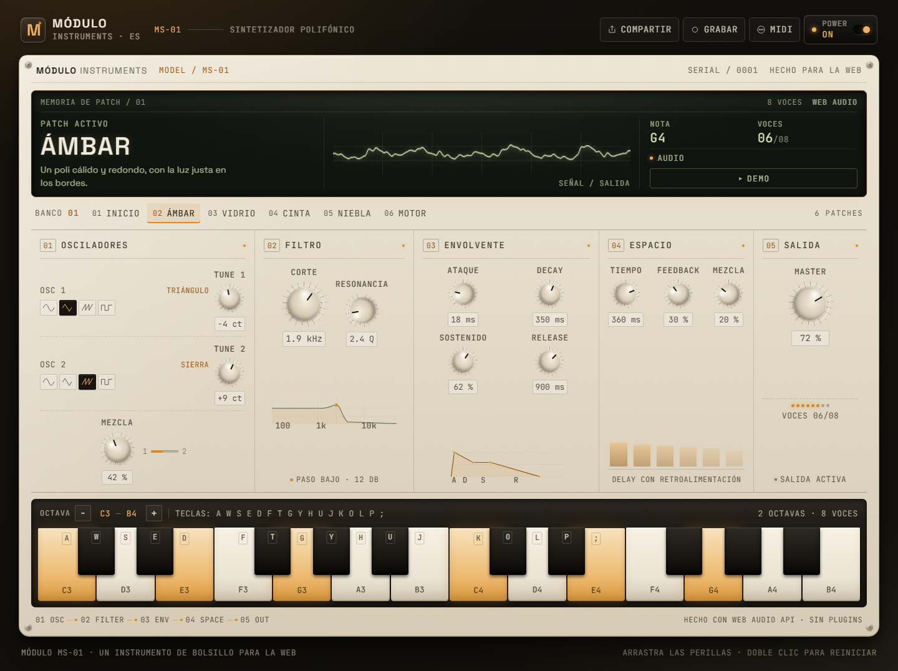

# MÓDULO MS-01

**Un sintetizador polifónico de bolsillo que vive en el navegador.**

MÓDULO MS-01 es una pieza de portfolio independiente: un instrumento real, no una
maqueta. Todo el sonido se genera en tiempo real con Web Audio API y toda la
interfaz está construida con React y CSS. No hay samples, plugins ni backend.

**Demo en vivo:** [alejandropd05.github.io/modulo-ms01](https://alejandropd05.github.io/modulo-ms01/) · **Código:** [github.com/AlejandroPD05/modulo-ms01](https://github.com/AlejandroPD05/modulo-ms01)



## La idea

La mayoría de los sintetizadores web esconden el instrumento detrás de un formulario.
MS-01 hace lo contrario: se presenta como un módulo de hardware de sobremesa, con un
chasis en perspectiva 2.5D, tornillos, una pantalla LCD y perillas que se pueden
arrastrar. La dirección visual es industrial cálida —marfil, ámbar y negro— para
alejarse deliberadamente del lenguaje azul/cian de otros proyectos de la serie.

El resultado busca tres cosas a la vez: que se entienda en dos segundos, que se pueda
tocar sin instrucciones y que el sonido esté a la altura del envoltorio.

## Características

- **8 voces reales** con robo de la voz más antigua cuando se supera el límite.
- **Dos osciladores por voz** con seno, triángulo, sierra o cuadrada.
- **Detune independiente** de ±50 cents y mezcla continua entre osciladores.
- **Filtro paso bajo** biquad de 12 dB/octava con corte y resonancia.
- **Envolvente ADSR** aplicada por voz, con ataques desde 5 ms y releases de hasta 4 s.
- **Delay compartido** de 40 a 750 ms con retroalimentación y mezcla.
- **Compresor y master** antes de la salida; la señal pasa por un analizador.
- **Seis presets**: `INICIO`, `ÁMBAR`, `VIDRIO`, `CINTA`, `NIEBLA` y `MOTOR`.
- **Teclado de dos octavas** (una en pantallas pequeñas), ratón, táctil y teclado físico.
- **Demo integrada** con un arpegio y acordes que muestran el patch activo.
- **Grabación y exportación** de la salida master con `MediaRecorder`.
- **MIDI opcional** vía Web MIDI: conecta un teclado y toca sin configuración.
- **Patches compartibles** como URL: los parámetros viajan comprimidos en el hash `#p=`.
- **Interfaz accesible** con perillas operables por teclado, foco visible, anuncios
  `aria-live` y respeto por `prefers-reduced-motion`.

## Cómo se usa

1. Pulsa **POWER** o toca una tecla. El audio necesita un gesto del usuario para
   arrancar, así que el primer encendido reproduce un pequeño arpegio de saludo.
2. Arrastra una perilla hacia arriba o abajo. Con `Shift` el ajuste es más fino;
   con doble clic vuelve a su valor por defecto.
3. Toca las teclas o usa el teclado físico: `A W S E D F T G Y H U J K` para la
   primera octava y `O L P ;` para completar la segunda cuando está visible.
4. Elige un preset en el banco. El LCD muestra el nombre, la nota actual y las voces.
5. **COMPARTIR** copia una URL con el patch. **GRABAR** exporta la interpretación.
   **MIDI** conecta un controlador compatible.

## Stack

| Capa | Elección |
| --- | --- |
| Build | Vite 8 + TypeScript 6 |
| UI | React 19 + Zustand 5 |
| Audio | Web Audio API nativa |
| Estilos | CSS propio, sin framework |
| Tipografía | Space Grotesk + JetBrains Mono (subset latin) |
| Pruebas | Vitest |

La interfaz no dibuja una escena 3D completa: el chasis se construye con gradientes,
sombras, biseles y transformaciones CSS. El único canvas es el visualizador de la
forma de onda, que lee el `AnalyserNode` del motor.

## Arquitectura

```text
src/
├─ audio/
│  ├─ parametros.ts   Modelo, rangos, presets, validación y codificación de patches
│  ├─ notas.ts        Frecuencias, nombres MIDI, mapa del teclado informático
│  └─ motor.ts        Motor imperativo de Web Audio
├─ estado/
│  └─ useSynth.ts     Estado global, patch desde URL, demo, grabación, MIDI y share
├─ componentes/
│  ├─ Cabecera.tsx    Power, share, grabación y MIDI
│  ├─ Pantalla.tsx    LCD, banco de presets y visualizador
│  ├─ Controles.tsx   Osciladores, filtro, envolvente, delay y salida
│  ├─ Perilla.tsx     Perilla accesible (pointer + teclado)
│  ├─ Teclado.tsx     Teclado virtual, octavas y atajos físicos
│  └─ Visualizador.tsx Osciloscopio sobre canvas
└─ estilos/index.css  Sistema visual, chasis 2.5D y responsive
```

El motor no depende de React. La UI solo envía intenciones:

```text
UI (React) ──> Zustand ──> MotorSynth ──> Web Audio
                    │                         │
                    └──── patches / URL       └──> AnalyserNode ──> canvas
```

La cadena de audio es:

```text
OSC 1 ─┐
       ├─> filtro ─> ADSR ─┬─> master ─> compresor ─> analizador ─> salida
OSC 2 ─┘                  └─> envío ─> delay ⟲ ─> master
```

Los parámetros se aplican a las voces activas con rampas cortas para evitar clics.
El primer arranque crea el `AudioContext`; apagar suspende el contexto en lugar de
destruirlo, y el estado visual de las voces se limpia junto con el audio.

### Patches compartibles

Un patch se serializa a JSON, se codifica en base64url y se coloca en el hash:

```text
https://…/#p=eyJvbmRhMSI6InNpbmUiLCJvbmRhMiI6…
```

Al cargar la página, `leerPatchDeUrl` valida el objeto contra los rangos permitidos,
recorta valores fuera de rango y rechaza tipos incorrectos. Si la decodificación
falla, el instrumento arranca con `ÁMBAR`. No se envía nada a un servidor.

## Accesibilidad

- HTML semántico: `header`, `main`, `nav`, `section`, `footer` y enlace de salto.
- Cada perilla es un `role="slider"` enfocable, con nombre, valor mínimo, máximo,
  valor actual y `aria-valuetext` formateado. Flechas, `PageUp/PageDown`, `Home` y
  `End` funcionan sin ratón.
- Las teclas virtuales son botones con `aria-label` y `aria-pressed`; además de
  pointer/touch, responden a `Espacio` y `Enter`.
- El estado del audio, el patch recibido, la grabación, el MIDI y el enlace copiado
  se anuncian con una región `aria-live`/`role="status"`.
- El foco visible usa el ámbar de la marca y nunca depende solo del color.
- `prefers-reduced-motion` reduce transiciones y detiene la animación del
  visualizador; el resto del instrumento sigue funcionando.
- En móvil se muestra una octava y los atajos físicos se limitan a las notas
  visibles para no tocar notas fuera de pantalla.
- Al desconectar MIDI se liberan las notas que estaban retenidas por el controlador.

Vista móvil: [captura completa](docs/captura-mobile.png).

## Desarrollo

```bash
npm install
npm run dev      # http://localhost:5174
npm run build    # comprobación de tipos + build de producción
npm run preview  # servidor local del build
npm run lint
npm test
```

El proyecto usa npm y `package-lock.json`. Cada push a `main` ejecuta lint, tests y
build en GitHub Actions y publica `dist` en GitHub Pages.

## Compatibilidad y límites

Funciona en navegadores modernos de escritorio y móviles con Web Audio API. Web MIDI
está disponible principalmente en navegadores basados en Chromium; la grabación usa
el primer formato soportado por `MediaRecorder` (WebM/Opus, Ogg o M4A en Safari).
La disponibilidad exacta de códecs y MIDI depende del navegador.

Límites intencionales de esta versión:

- Un solo delay compartido, no un delay por voz.
- Sin persistencia local ni cuentas; el patch vive en la URL.
- Sin MIDI Learn ni asignación de controladores.
- Sin backend ni analítica.

## Contexto

MS-01 es una pieza independiente de una serie de instrumentos web. Está pensada para
ser explorada, no para competir en features con un DAW: el objetivo es demostrar
criterio de producto, diseño de interfaz, ingeniería de audio y atención al detalle
en una sola pantalla.
